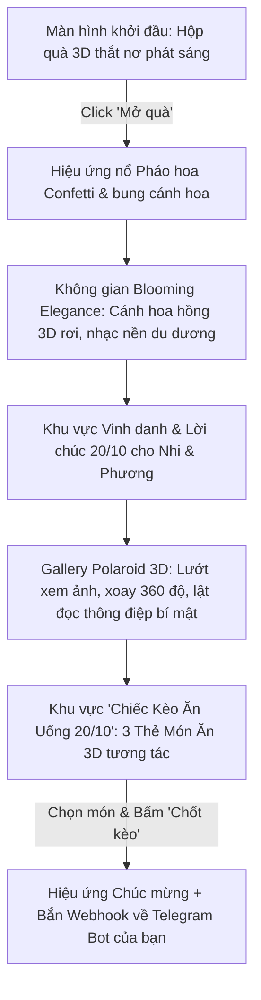
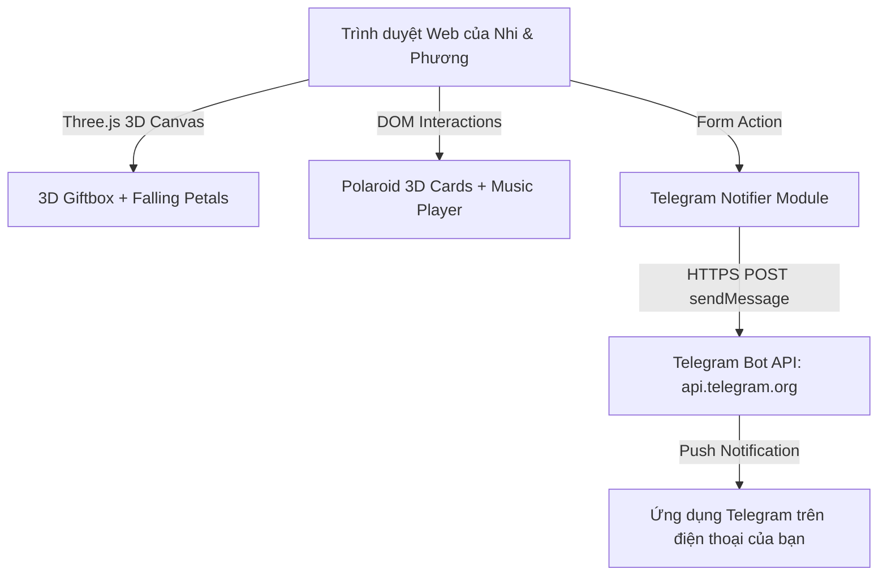

Started at:  2026/10/17 23:18:41
Finished at: 2026/10/17 23:22:15
Total time: 4 minutes
---

# Vision & Architecture: Trang Web Chúc Mừng 20/10 (Nhi & Phương)

## 1. Tầm nhìn & Mục tiêu (Vision & Goals)

### 1.1. Chúng ta đang xây dựng cái gì? (What)
Một trang web trải nghiệm tương tác (Interactive 3D Web Experience) kỷ niệm ngày Phụ nữ Việt Nam 20/10 dành riêng cho hai người bạn đặc biệt: **Nhi** và **Phương**.
Trang web kết hợp mượt mà giữa nghệ thuật thị giác 3D (Three.js), bộ sưu tập kỷ niệm ảnh Polaroid 3D tương tác, cùng mini-game lựa chọn bữa tiệc ẩm thực (3 lựa chọn món ăn) có khả năng tự động gửi kết quả lựa chọn về **Telegram Bot** của chủ nhân ngay lập tức.

### 1.2. Tại sao chúng ta xây dựng? (Why)
- Thay vì gửi một tin nhắn văn bản thông thường, đây là món quà bất ngờ, tinh tế, độc đáo và đầy ắp sự chu đáo.
- Tạo trải nghiệm "WOW" từ giây đầu tiên bước vào cho đến hành động chốt món ăn đi chơi chung.

### 1.3. Đối tượng thụ hưởng (For Whom)
- **Nhi & Phương**: Hai nhân vật chính, nhận được lời chúc được cá nhân hóa, xem ảnh kỷ niệm lung linh và tự do chọn món ăn mình thích nhất.
- **Người tặng (Chủ nhân trang web)**: Nhận thông báo tức thời qua Telegram Bot biết bạn nữ đã chọn món gì để kịp chuẩn bị đặt bàn và hầu bao chu đáo.

### 1.4. Tiêu chí thành công (Success Criteria)
| # | Tiêu chí | Cách đo lường / Đánh giá |
|---|----------|--------------------------|
| 1 | Hiệu ứng 3D "WOW" mượt mà | Không gian 3D Three.js mượt 60fps trên cả mobile & desktop, kết hợp cả 3 concept: Mở hộp quà 3D -> Hoa rơi bừng nở -> Gallery Polaroid 3D |
| 2 | Tính cá nhân hóa cao | Lời chúc, hình ảnh riêng biệt rõ ràng cho Nhi và Phương; có thể chuyển đổi linh hoạt |
| 3 | Trải nghiệm chọn món & Gửi tin nhắn tin cậy | 3 lựa chọn món ăn hấp dẫn + tùy chọn nhập món; ấn gửi là Telegram Bot nhận tin nhắn ngay lập tức trong < 1.5s |
| 4 | Thân thiện trên di động | Giao diện Responsive tối ưu cho màn hình smartphone (do các bạn nữ thường mở link qua Zalo/Messenger trên điện thoại) |

---

## 2. Ý tưởng Kịch bản Trải nghiệm Logic (The Unified 3D Journey)

Kết hợp cả 3 ý tưởng mà người dùng đã chọn theo thứ tự mạch cảm xúc (Emotional Arc):



### Chi tiết từng giai đoạn:
1. **Giai đoạn 1 - Surprise Gift Box (Hộp quà bất ngờ 3D)**:
   - Nền tối mờ huyền ảo, hộp quà 3D ở giữa với dải ruy băng lấp lánh và hiệu ứng đốm sáng (sparkles/particles).
   - Nút kêu gọi hành động: *"Gửi tới Nhi & Phương - Chạm để mở quà"*.
   - Khi bấm: Nơ mở tung, hộp quà mở nắp kèm âm thanh vui tươi nhẹ nhàng, pháo hoa confetti bung nổ.

2. **Giai đoạn 2 - Blooming Elegance (Hoa nở lung linh)**:
   - Từ hộp quà chuyển tiếp sang khung cảnh hoa bừng nở: Hàng ngàn cánh hoa hồng và hoa anh đào 3D chầm chậm rơi lượn sóng trong không gian Three.js.
   - Bảng chữ thư pháp hiện đại tỏa sáng: *"Chúc Mừng Ngày Phụ Nữ Việt Nam 20/10 - Rạng rỡ & Hạnh phúc!"*.
   - Nhạc nền (Audio BGM acoustic lãng mạn, có nút bật/tắt âm thanh tinh tế góc trên).

3. **Giai đoạn 3 - 3D Polaroid Scrapbook (Khu kỷ niệm ảnh Nhi & Phương)**:
   - Công tắc chuyển đổi (Tab): **"Dành cho Nhi 🌸"** & **"Dành cho Phương 🌷"**.
   - Thẻ ảnh phong cách Polaroid 3D nghiêng bay bổng, có hiệu ứng tương tác:
     - Rê chuột / Chạm tay: Thẻ ảnh nổi lên, xoay theo cử động chuột (3D tilt & rotation).
     - Click vào ảnh: Ảnh lật mặt sau (3D flip card) hé lộ lời chúc riêng hoặc câu kỷ niệm dí dỏm.
     - Có sẵn chỗ để chèn link ảnh/tệp ảnh thực tế của hai bạn.

4. **Giai đoạn 4 - Menu Ẩm Thực 20/10 (3 Lựa chọn món ăn + Custom)**:
   - Thông điệp: *"20/10 tớ bao trọn gói, nàng chỉ việc chọn món nàng mê nhất!"*.
   - 3 Thẻ bài 3D tương tác đại diện cho 3 phong cách ẩm thực được tuyển chọn:
     - **Option 1: Đại tiệc Buffet Lẩu / Nướng Haidilao / Manwah / Gyu-Kaku** (Ấm cúng, thả ga no nê).
     - **Option 2: Ẩm thực Nhật/Hàn (Sushi, Sashimi, K-BBQ) + Trà sữa Full Topping** (Tươi ngon, chuẩn gu nàng).
     - **Option 3: Bữa tối Bistro Rooftop Lãng Mạn (Steak mềm mọng, Pasta & View ngắm phố)** (Chill, sang chảnh, chụp ảnh đẹp).
     - *Tùy chọn mở rộng (Custom Option)*: Một ô nhập liệu *"Hoặc món bất kỳ nàng đang thèm..."*.
   - Radio/Checkbox chọn người vote: *"Nhi chọn"*, *"Phương chọn"*, hoặc *"Cả hai đứa tớ đồng lòng"*.

5. **Giai đoạn 5 - Telegram Bot Webhook & Màn kết "Chốt Kèo"**:
   - Khi bấm **"Chốt Món Này Nha! ✨"**:
     - Hiệu ứng tim đỏ và pháo hoa rực sáng.
     - Dữ liệu được gửi ngay tức thì về Telegram Bot của bạn với cú pháp thông báo bắt mắt:
       ```text
       🎉 THÔNG BÁO KÈO 20/10 MỚI!
       🌸 Người chọn: Nhi (hoặc Phương / Cả hai)
       🍽️ Món đã chọn: Đại tiệc Buffet Lẩu Haidilao
       💬 Ghi chú thêm: (nếu có)
       ⏰ Thời gian: 20:30 - 20/10/2026
       👉 Chuẩn bị ví và liên hệ đặt bàn ngay thôi bro!
       ```
     - Trên web hiển thị pop-up đáng yêu: *"Đã nhận thông điệp! Giờ thì Nhi & Phương chuẩn bị lên đồ thật xinh nhé, hẹn ngày 20/10!"*.

---

## 3. Kiến trúc Kỹ thuật (Technical Architecture)



### 3.1. Frontend Stack
- **Cốt lõi**: HTML5 semantic, Vanilla CSS3 (Custom Properties, Glassmorphism, 3D Transforms, Flexbox/Grid), Vanilla JavaScript ES6+ (Module hóa sạch sẽ, hiệu năng cao).
- **Thư viện 3D**: `Three.js` (r128 qua CDN hoặc bundler) để tạo hạt (particles), hộp quà 3D, cánh hoa rơi xoay tự nhiên trong trục không gian 3 chiều.
- **Thư viện hiệu ứng hỗ trợ**:
  - `canvas-confetti` (cho màn nổ pháo hoa rực rỡ khi mở hộp quà).
  - Web Audio API / HTML5 Audio cho phát nhạc nền mượt mà, không bị chặn bởi chính sách Autoplay của trình duyệt.

### 3.2. Telegram Bot Integration Module
- Client gọi trực tiếp endpoint `POST https://api.telegram.org/bot<BOT_TOKEN>/sendMessage`.
- Để thuận tiện và an toàn:
  - Cung cấp cấu hình tập trung trong `config.js` (`TELEGRAM_BOT_TOKEN`, `TELEGRAM_CHAT_ID`).
  - Đi kèm cơ chế Fallback: Nếu mạng chập chờn hoặc bot API bị chặn, web sẽ tự động kích hoạt nút dự phòng *"Gửi qua Zalo/Messenger"* với tin nhắn soạn sẵn chỉ bằng 1 cú chạm.

---

## 4. Rủi ro & Giải pháp giảm thiểu (Risks & Mitigations)

| # | Rủi ro | Mức độ | Giải pháp kỹ thuật |
|---|--------|--------|---------------------|
| 1 | Autoplay Audio bị trình duyệt chặn | Trung bình | Kích hoạt âm thanh ngay khi người dùng chạm vào nút "Mở hộp quà 3D" (User Gesture đáp ứng tiêu chuẩn Browser Policy). |
| 2 | Three.js gây lag trên điện thoại cũ | Thấp | Tối ưu số lượng hạt particles (khoảng 60-100 cánh hoa), bật `powerPreference: "high-performance"`, tự động giảm phân giải nếu FPS sụt giảm. |
| 3 | Lộ Telegram Bot Token nếu host tĩnh công khai | Trung bình | Có hướng dẫn tạo Bot riêng biệt chỉ có quyền gửi tin nhắn vào Chat ID cá nhân của bạn, hoặc hướng dẫn tạo Cloudflare Worker / Serverless proxy miễn phí nếu muốn giấu token tuyệt đối. |

---

## 5. Domain Skills Được Tham Chiếu
- `brainstorming`: Kết hợp và phát triển 3 ý tưởng thành một mạch hành trình cảm xúc liền mạch.
- `ui-ux-pro-max`: Nguyên tắc màu sắc pastel Rose Gold sang trọng, Typography font Google (Playfair Display / Quicksand / Montserrat), Micro-interactions 3D mượt mà.
- `api-design`: Cấu trúc request payload rõ ràng tới Telegram Bot API và cơ chế xử lý lỗi/fallback thông minh.
